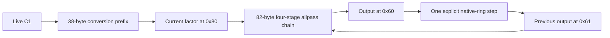

# Original BMC allpass oscillator candidate

2026-11-10. `bmc_allpass_oscillator.py` generates an original 120-byte
oscillator fragment from the existing supported packet profiles. Its sample
arithmetic executes those bytes in the strict interpreter. The host seeds
five values once, maps the explicit native sample ring, and advances its
origin once per software frame. There is no per-sample host sine calculation,
phase recurrence, waveform lookup or program switching.

This is an offline synthesis-core candidate. Its native-ring convention,
initial-state encoding, chip precision, task wrapper, scheduling and physical
audio routing still require validation. It is not load-ready Fantom firmware.

The [stereo voice body](original-bmc-stereo-voice.md) now appends the supported
80-byte gain/scratch-output profile. It shares this core's exact initialization
and ring state, while taking both audio channels from actual tail execution.
The original mono samples and metadata remain unchanged.

## Static program and feedback

The same two logical byte slices run on every frame.

| Slice | Size | Role |
|---|---:|---|
| `coefficient_shift4` | 38 bytes | Convert live C1 into the current allpass factor; C0 is zero |
| `allpass4` | 82 bytes | Advance four allpass stages and save output/history |

Their concatenation has ten packets and SHA-256
`862b9980474af2bb1cda72b4bbbf36ac7dcd54fd4d82d6ac17c347d41cebe21f`.
No new opcode or emitter profile is admitted. The first slice's input-mix
result is unused; nonzero external input values produce identical oscillator
output in the test. All arithmetic inputs used by the allpass chain are loaded
again, so the composition needs no incoming port values under the existing
functional model.



Each stage uses the checked recurrence
`v[n] = u[n-1] + q * (v[n-1] - u[n])`.
The fourth output feeds the first input after one model frame. With origin
`O`, logical address `a` maps to `(a-O) & 0x7ff`, and `O` advances by one
after the entire frame. This makes store/read pairs separated by one a
previous-frame relationship.

| Current store | Following-frame read | State |
|---|---|---|
| `20` | `21` | Previous chain input |
| `30` | `31` | First stage |
| `40` | `41` | Second stage |
| `50` | `51` | Third stage |
| `60` | `61` | Output fed back to input |
| `70` | `71` | Duplicate output history used by the fourth stage |

Addresses in this table are hexadecimal. Factor `80` is refreshed and read
within the current frame. All thirteen referenced logical data indices are
distinct, satisfying the original allpass profile's restrictions. This
placement is an experiment, not an owned hardware reservation.

## Pitch and initial state

For requested frequency `F` on the software 48 kHz grid, compute

```text
w = 2*pi*F/48000
K = tan((2*pi-w)/8) / tan(w/2)
f = (K-1)/(K+1)
```

C0 is zero and C1 is `f/16`. The emitted prefix performs its actual binary32
read, fixed32 conversion and shift by four. The resulting factor `q` must
stay strictly inside `(-1,1)`. Pitch calibration uses this quantized value,
solving the feedback condition for the fundamental

```text
w_actual + 8*atan(((1+q)/(1-q))*tan(w_actual/2)) = 2*pi
```

The stage phase is `phi = -2*atan(((1+q)/(1-q))*tan(w_actual/2))`.
For amplitude `A`, a zeroed ring receives these six logical seed slots

```text
21 = A*sin(-2*w_actual)
31 = A*sin(-2*w_actual + phi)
41 = A*sin(-2*w_actual + 2*phi)
51 = A*sin(-2*w_actual + 3*phi)
61 = 71 = A*sin(-w_actual)
```

The final value is computed once and copied, making five sine evaluations.
These seeds select the intended oscillatory mode. An entirely zero state
stays silent. The JSON exposes `initial_data` and `coefficients` for review.
Their values follow the native-policy binary64 model; hardware data encoding
is still unverified. Frequency changes and reseeding during a running voice
are outside this prototype.

The [typed initialization study](state-initialization-and-float-writers.md)
now identifies this native ring as enum 0 and checks the Fantom's corresponding
binary32 writer. Rounding only the six seeds to CPU binary32 changes the
12,000-frame software output by less than `7e-9` in two checked pitches.
The chip's conversion remains unverified, and the stock per-DSP readers reject
this enum. These findings narrow initialization without supplying ownership,
a readback path or load-ready bytes.

## Measured offline behavior

At requested 440 Hz, the quantized factor predicts `440.000197628852 Hz`.
Across 12,000 frames at amplitude `0.25`, maximum error against the calibrated
reference sine is `3.1290942059669646e-14`; peak is
`0.24999999999247058`. At 9,600 Hz the quantized factor is zero, giving a
five-sample period. Its 12,000-frame reference error is
`3.690022208227137e-13`.

Eight tests check emitted/inverse-decoded profiles, two origin wraps,
calibrated waveform agreement, deterministic output, zero amplitude,
external-input independence, invalid/unrepresentable parameters and output
preservation. A patched sine function permits only initialization calls.
A separate CLI test runs with an absent vendor-corpus directory.
Qwen wrote and tested the core. Local review retained its packet/state loop,
reused existing numeric/PCM helpers, fixed output creation and measured the
longer runs independently. The worker's smaller claimed error was not used.

```sh
python tools/bmc_allpass_oscillator.py local/bmc-allpass-oscillator.wav \
  --frequency 440 --frames 12000 > local/bmc-allpass-oscillator.json
python -m unittest discover -s tests -p test_bmc_allpass_oscillator.py -v
```

This needs Python 3.13+ and project dependencies, with no vendor binary corpus.
The WAV is mono; both files are generated under the project. The CLI refuses
to replace existing output. An original logical binary can be exported through
`b''.join(programs())` using a new-output-only file.

Concatenate the logical fragments before stored-order conversion. The
38-byte prefix ends halfway through a 32-bit stored word. Padding or swapping
each fragment independently would change the combined program. The complete
120-byte logical stream needs no final padding; `swap_words(logical)` converts
the whole stream for an offline stored-order comparison. It does not supply
an entry/return wrapper or authorize loading.

## Requirements before instrument use

The program still needs an owned task and data/coefficient allocation, verified
initial-data encoding and initialization order, a proven entry/return wrapper,
actual sample cadence and physical output routing. Precision and feedback
stability must be measured on BMC silicon; unity feedback can accumulate
roundoff modes under a different arithmetic policy. Live amplitude/envelope
control, note events and polyphonic resource management are later engine work.
The reported hardware and full-engine readiness flags remain false.
